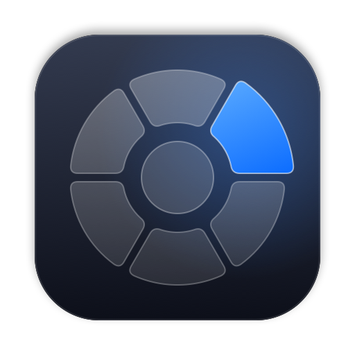
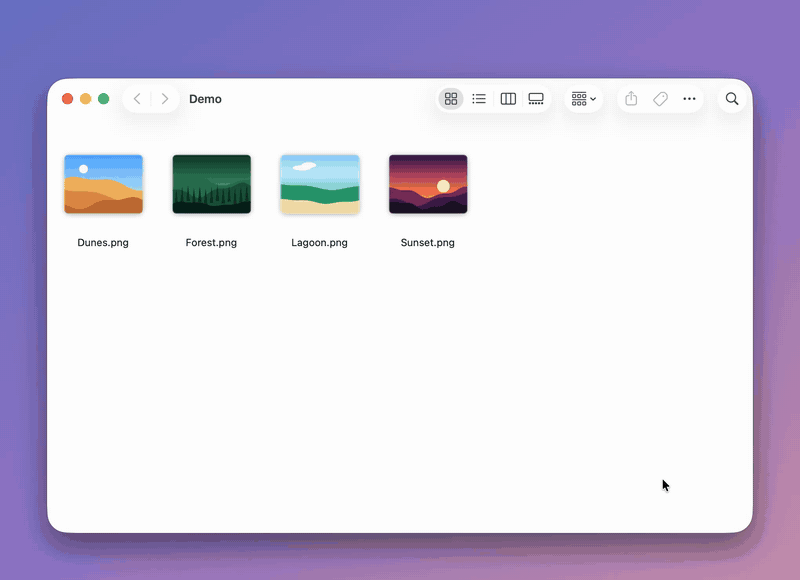
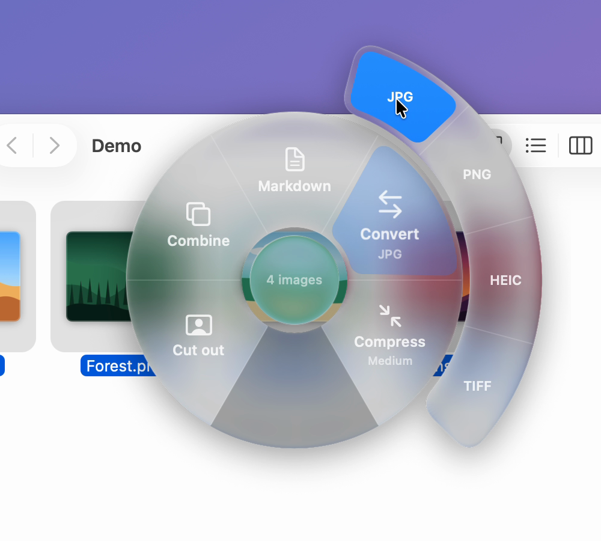
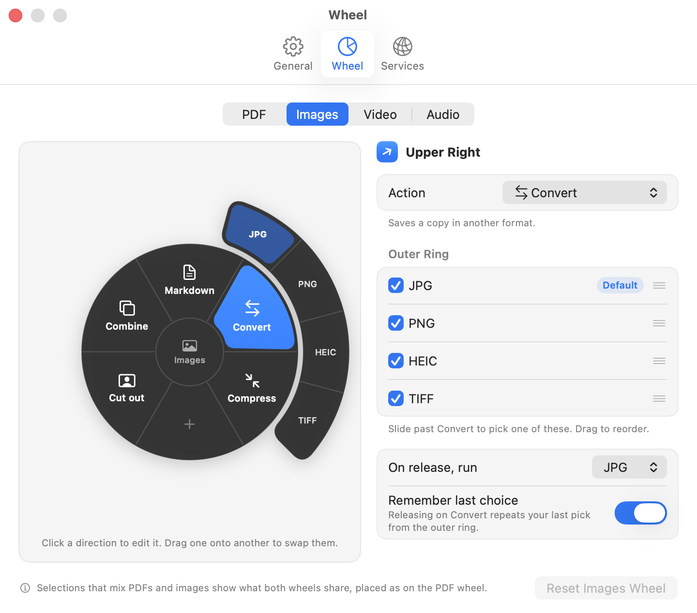

  

<h1 align="center">Finder Wheel</h1>

  A gesture wheel for Finder. Select files, hold <kbd>⌥</kbd> <kbd>Space</kbd>, flick toward an action, release.

  <a href="https://github.com/lorenz418/finder-wheel/releases/latest"><b>Download for macOS</b></a>
  &nbsp;·&nbsp; macOS 26 or later &nbsp;·&nbsp; Apple silicon

  

Convert, compress, combine, split, cut out, transcribe and OCR files without opening an app. Everything runs on your Mac, except Markdown for PDFs and images, which uses the Mistral OCR API.

## Install

1. Download the zip from the [latest release](https://github.com/lorenz418/finder-wheel/releases/latest) and unzip it.
2. Move **Finder Wheel** to your Applications folder and open it.
3. The first time, macOS blocks the app because it is not notarized by Apple. Open **System Settings → Privacy & Security**, scroll down, and click **Open Anyway**.
4. The first time you use the wheel, macOS asks whether Finder Wheel may control Finder. Allow it: this is how the app reads which files are selected.

Finder Wheel lives in the menu bar; there is no Dock icon. To start it with your Mac, turn on **Open at login** in its settings.

## How it works

| | |
|---|---|
| **1. Select** files in Finder. | The wheel shows the actions that fit them: PDFs, images, video and audio each have their own wheel. |
| **2. Hold** <kbd>⌥</kbd> <kbd>Space</kbd>. | The wheel appears under the cursor. |
| **3. Flick** toward an action and **release**. | The action runs. Press <kbd>Esc</kbd> to cancel instead. |
| **4. Slide further out** for alternatives. | Actions with several options, like Convert, open an outer ring. A plain release repeats your last choice. |

  

Originals are never changed. Results appear next to them and are selected in Finder. Progress and results show in the menu bar.

## Actions

These are the defaults. Every direction can be changed.

| Direction | PDF | Image | Video / audio |
|---|---|---|---|
| Up: **Markdown** | Mistral OCR | Mistral OCR | On-device transcript |
| Upper right: **Convert** | PNG, JPG (one image per page) | JPG, PNG, HEIC, TIFF | MP4, GIF, M4A |
| Lower right: **Compress** | Light, medium, strong | Light, medium, strong, 2000 px | Light, medium, strong |
| Lower left | **Split** into pages | **Cut out** the subject | |
| Upper left: **Combine** | Merge into one PDF | Into one PDF | |

Markdown for a PDF also saves its figures: next to `report.md` you get a folder `report-assets` with every figure as a PNG, cut out of the original PDF at 600 DPI, and the Markdown links to them. For a photo or screenshot, figures are cropped from the original pixels.

Convert to MP4 re-wraps the video without re-encoding when it is MP4-compatible (keeps HEVC and HDR, near-instant); otherwise it re-encodes.

## Make it yours

Click the menu bar icon, then **Settings**.

  

- **General**: the hotkey, opening at login, and whether location data is removed from images.
- **Wheel**: arrange the wheel separately for PDFs, images, video and audio. Click a direction to choose its action, which options its outer ring shows and in what order, which option a plain release runs, and whether it remembers your last choice. Drag one direction onto another to swap them.
- **Services**: the Mistral API key (stored in your Keychain) and the transcription language.

Selections that mix PDFs and images, or video and audio, show the actions both wheels share, placed as on the PDF or Video wheel.

## Privacy

Files stay on your Mac. The one exception is the Markdown action on PDFs and images, which uploads those files to [Mistral](https://mistral.ai) for OCR; the app asks before the first upload and needs your own API key. Transcription of video and audio runs on your Mac.

## Known limitations

- PDF Compress shrinks scanned and image-heavy PDFs; text-only PDFs are reported as "Already as small as it gets". It may lower the quality of already-low-resolution scans (like Preview's Reduce File Size).
- Video Compress produces H.264 and converts HDR to SDR. For iPhone HEVC clips the light preset is often not smaller and is reported as "Already as small as it gets".
- Video to GIF converts the whole video. Trim long videos first. Videos narrower than 480 px keep their width.
- WebP and GIF cannot be written. GIF files are not accepted as input.
- The wheel works in Finder only.

## Build from source

Requires Xcode 27 or later.

    scripts/build-app.sh
    open "build/Finder Wheel.app"

The app is signed ad hoc, so macOS asks for the Finder permission again after each rebuild. To avoid that, sign with a development certificate:

    SIGN_IDENTITY="Apple Development: Your Name (TEAMID)" scripts/build-app.sh

`scripts/package.sh` builds the app and zips it for a release. `swift scripts/make-icon.swift` redraws the app icon.

### Development

    swift test

If the repository is inside an iCloud-synced folder (Desktop, Documents), `swift build` and `swift test` fail at code signing. Point them at a build folder outside it:

    swift test --scratch-path /tmp/finder-wheel-build
    BUILD_DIR=/tmp/finder-wheel-build scripts/build-app.sh

Logic and file actions are in `Sources/FinderWheelCore` and covered by tests. The app shell is in `Sources/FinderWheel`. Manual checks are in `docs/manual-checks.md`. The design is in `docs/superpowers/specs/2026-11-12-finder-wheel-design.md`.
